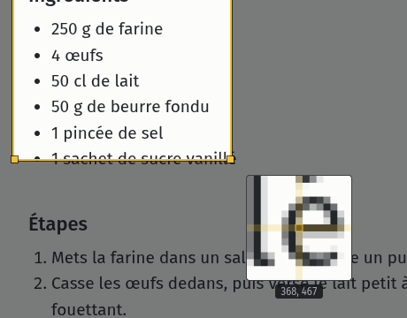
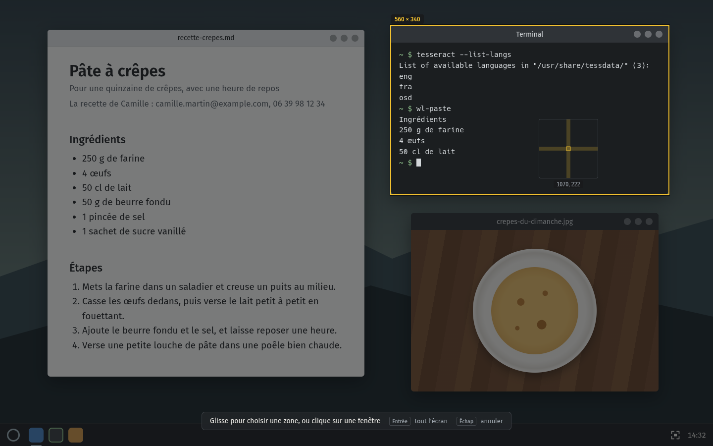
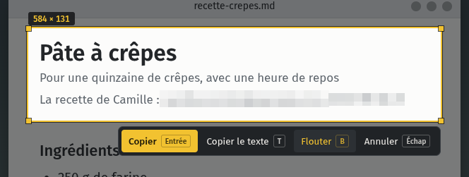
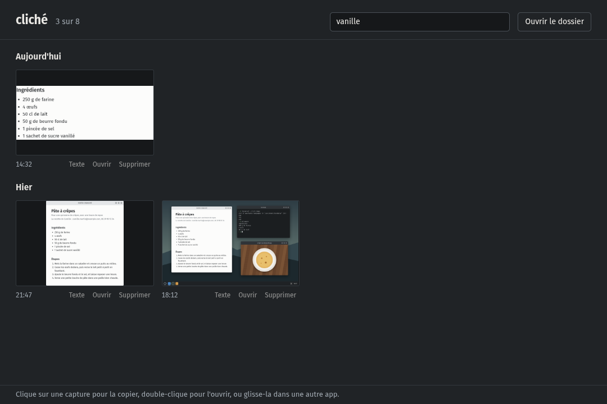

<div align="center">


# cliché

Captures d'écran pour KDE Plasma sous Wayland, avec un historique et la lecture du texte en local.

[](../../releases/latest)
[](../../releases/latest)

<br />


</div>

<br />

J'en avais marre de galérer dès que je voulais copier le texte d'une image sur KDE. Alors j'ai fait cliché : tu appuies sur Impr, tu choisis une zone, et l'image part dans ton presse-papiers. Appuie sur T à la place, et c'est le texte de la zone que tu récupères, lu directement sur ta machine.

## 📸 Ce qu'il y a dedans

Appuie sur `Impr`, l'écran se fige tout de suite et s'assombrit. Glisse pour choisir une zone, sa taille en pixels s'affiche juste au-dessus. Pendant que tu vises, une petite loupe suit ton curseur et grossit les pixels autour, pratique pour tomber pile sur le bord d'un bouton.

<div align="center">

</div>

Une fois la zone tracée, tu peux la déplacer, tirer sur un bord ou un coin, ou l'ajuster au pixel près avec les flèches. Entrée copie la zone et l'enregistre dans `Images/Screenshots`, puis une petite notification te montre l'aperçu (un clic dessus ouvre l'historique). Sans zone, Entrée prend tout l'écran.

| Dans l'écran de sélection                      | Ce que ça fait                               |
| ---------------------------------------------- | -------------------------------------------- |
| Glisser                                        | Choisir une zone                             |
| Clic sur une fenêtre                           | Prendre toute la fenêtre                     |
| Glisser un bord, un coin ou l'intérieur        | Ajuster ou déplacer la zone                  |
| Flèches                                        | Déplacer la zone d'un pixel (10 avec `Ctrl`) |
| `Maj` + flèches                                | Agrandir ou réduire la zone                  |
| `Entrée`, `Ctrl+C` ou double-clic dans la zone | Copier et enregistrer                        |
| `T`                                            | Copier le texte de la zone                   |
| `B`                                            | Flouter les infos perso, puis ce que tu veux |
| `Échap` ou clic droit                          | Annuler                                      |

## 🪟 Capturer une fenêtre d'un clic

Passe la souris sur une fenêtre, elle s'éclaire avec sa taille au-dessus. Un clic et c'est elle qui est sélectionnée, barre de titre comprise, sans avoir à tracer quoi que ce soit. Double-clique dessus pour la copier direct.

<div align="center">

</div>

Ça marche aussi avec le panneau de Plasma ou une boîte de dialogue.

## 🌫️ Flouter avant de copier

Appuie sur `B` (ou sur Flouter dans la barre) : cliché lit la zone et floute tout seul les adresses mail, numéros de téléphone, IBAN, numéros de carte et clés d'API qu'il y trouve. En bas de l'écran, il te dit combien il en a caché.

<div align="center">

</div>

Il en a raté un, ou tu veux cacher autre chose ? Glisse dessus, ça part en gros pixels aussi. `Ctrl+Z` retire le dernier flou, et un nouvel appui sur `B` te rend la main pour ajuster la zone. Si tu appuies sur Entrée pendant qu'il cherche encore, la copie attend qu'il ait fini, comme ça rien ne part en clair.

> [!NOTE]
> cliché ne repère que ce que Tesseract arrive à lire. Sur un texte minuscule ou flou, jette quand même un œil avant d'envoyer.

## 🔤 Copier le texte d'une image

Dans l'écran de sélection, appuie sur `T` au lieu d'Entrée : cliché lit le texte de la zone et le copie à la place de l'image. Une notification te montre le début de ce qu'il a compris, comme ça tu vois tout de suite si c'est bon. Dans ce cas l'image n'est pas enregistrée, seul le texte part dans le presse-papiers.

La lecture marche en français et en anglais, avec [Tesseract](https://github.com/tesseract-ocr/tesseract) qui tourne en local. cliché agrandit les petites zones avant de les lire, donc même le texte d'un menu ou d'une légende passe bien.

## 🗂️ L'historique

L'historique range toutes tes captures par jour : aujourd'hui, hier, puis la date. Clique sur une image pour la recopier, double-clique pour l'ouvrir dans ta visionneuse, ou glisse-la directement dans une autre app. Sous chaque capture, t'as aussi Texte pour copier ce qu'elle contient, Ouvrir, et Supprimer, qui l'envoie à la corbeille.

<div align="center">

</div>

Le plus pratique, c'est la recherche. cliché lit le texte de tes captures en arrière-plan, du coup tu tapes un mot dans le champ en haut et il ne te montre que celles qui le contiennent. Pas besoin de mettre les accents ni les majuscules : « vanille » trouve « Vanillé ».

<div align="center">

</div>

Pour l'ouvrir, clique sur l'icône de cliché dans la barre système, ou sur la notification juste après une capture. Le clic droit sur l'icône te propose aussi de lancer une capture, d'ouvrir le dossier ou de couper le lancement au démarrage. Au clavier, `Ctrl+F` va dans la recherche, `T` lit le texte de la capture sélectionnée et `Suppr` la met à la corbeille.

## 📥 Installation

1. Télécharge `cliche-x.x.x.pacman` sur la [page des versions](../../releases/latest).
2. Installe-le avec `sudo pacman -U cliche-x.x.x.pacman`. pacman ajoute tout seul `wl-clipboard` et Tesseract avec le français et l'anglais.
3. Lance cliché depuis le menu : il s'installe dans la barre système et se relancera tout seul à chaque ouverture de session. Appuie sur `Impr` pour essayer.

> [!NOTE]
> Par défaut, Spectacle (l'outil de capture de KDE) garde la touche Impr pour lui, et cliché te prévient qu'elle est déjà prise. Va dans Configuration du système → Clavier → Raccourcis, retire Impr à Spectacle, puis donne-la à cliché.

Le paquet est fait pour Arch et ses dérivés, comme CachyOS ou EndeavourOS. Sur une autre distribution, cliché s'installe depuis les sources avec `pnpm install:linux` (tout est expliqué dans la partie bidouille, tout en bas).

## 🔄 Les mises à jour

Pas de mise à jour automatique pour l'instant. Quand une nouvelle version sort, télécharge le nouveau paquet et installe-le pareil, il remplace l'ancien. Tes captures ne bougent pas, elles restent dans `Images/Screenshots`.

## 🔒 Et tes données ?

Rien ne sort de ta machine. L'image de l'écran passe directement de KWin à cliché sans fichier temporaire, la lecture du texte tourne en local avec Tesseract, et cliché ne contacte aucun serveur. Pour le clic sur une fenêtre, il demande juste à KWin où sont les fenêtres ouvertes, pas leur titre ni leur contenu.

Tes captures sont de simples fichiers PNG dans `Images/Screenshots`, nommés avec la date et l'heure (`2026-11-04_14-32-10.png`). Tu peux les déplacer, les renommer ou les supprimer comme n'importe quel fichier, l'historique suit tout seul.

Pour la recherche, cliché garde le texte lu dans tes captures dans `~/.config/cliche/text-index.json`. Tu peux le supprimer quand tu veux, il relira tes captures la prochaine fois que tu ouvres l'historique.

## 🤔 Si ça coince

<details>
<summary><b>« La capture a échoué »</b></summary>
<br />
cliché demande l'image de l'écran à KWin, le gestionnaire de fenêtres de Plasma, et ce message veut dire qu'il n'a pas répondu. Vérifie que t'es bien dans une session Plasma 6 sous Wayland, puis relance cliché. Le détail de l'erreur est écrit dans la notification, sous le titre.
</details>

<details>
<summary><b>« Il manque des outils à cliché »</b></summary>
<br />
La notification dit quels paquets installer. Avec le paquet pacman ils arrivent tout seuls, donc ça arrive surtout quand tu installes depuis les sources.
</details>

<details>
<summary><b>La recherche ne trouve pas une capture</b></summary>
<br />
cliché lit tes captures une par une en arrière-plan. Tant que le compteur en haut de l'historique affiche « encore N à lire », certaines ne sont pas encore passées. Si le texte est flou ou très petit, Tesseract a pu mal le lire : la recherche ne trouve que ce qu'il a compris.
</details>

<details>
<summary><b>« Aucun texte trouvé »</b></summary>
<br />
Tesseract n'a rien reconnu dans la zone. Prends un peu plus large autour du texte, et s'il est flou, zoome sur la page avant de capturer.
</details>

<details>
<summary><b>L'icône a disparu de la barre système</b></summary>
<br />
Elle se cache sûrement derrière la petite flèche de la barre système. Fais un clic droit sur la flèche, ouvre les réglages de la boîte à miniatures et passe cliché sur « Toujours affiché ».
</details>

<details>
<summary><b>Je veux désinstaller cliché</b></summary>
<br />
Coupe d'abord le lancement au démarrage dans le clic droit sur l'icône, puis quitte cliché. Avec le paquet, lance <code>sudo pacman -R cliche</code>. Depuis les sources, supprime <code>~/Applications/cliche</code> et <code>~/.local/share/applications/cliche.desktop</code>. Tes captures restent dans <code>Images/Screenshots</code>.
</details>

---

<details>
<summary>🛠️ <b>Pour bidouiller le code</b></summary>

<br />

Electron, electron-vite et TypeScript strict, plus deux petits programmes en C pour parler à KWin. Node 24+ et pnpm 10+.

### Prérequis

- KDE Plasma 6 sous Wayland
- `gcc`, `pkgconf` et `libsystemd` pour compiler les helpers C
- `wl-clipboard` et `tesseract` (avec `tesseract-data-fra` et `tesseract-data-eng`) dans le PATH

### Commandes

```bash
pnpm install
pnpm dev              # compile les helpers C et lance l'app en mode développement
pnpm typecheck
pnpm lint
pnpm test
pnpm format
pnpm build:linux      # génère dist/linux-unpacked et le paquet dist/cliche-x.x.x.pacman
pnpm install:linux    # build, puis installe dans ~/Applications/cliche avec l'entrée de menu
```

Pour publier une version : monte `version` dans `package.json`, lance `pnpm build:linux`, puis joins `dist/cliche-x.x.x.pacman` à une release GitHub.

### Comment ça marche

`native/kwin-grab.c` demande l'image de l'écran à KWin par D-Bus (`org.kde.KWin.ScreenShot2`) et la renvoie en pixels bruts sur sa sortie, sans passer par un fichier. En même temps, `native/kwin-windows.c` charge un petit script KWin qui lui renvoie la position des fenêtres visibles, ce qui permet le clic sur une fenêtre. La fenêtre de sélection est créée au démarrage et reste cachée, prête à s'afficher dès que tu appuies sur Impr. Le raccourci est enregistré dans `kglobalaccel`, c'est pour ça qu'il apparaît dans les réglages de KDE.

Les icônes sont dessinées dans `resources/source/icon.svg` et `resources/source/tray.svg`. Si tu les modifies, `sh scripts/render-icons.sh` régénère les PNG (il faut `rsvg-convert`).

Pour refaire les captures du README : `CLICHE_SCREENSHOT=docs pnpm dev`. L'app dessine un faux bureau (`docs/scene`), y vise avec la loupe, survole une fenêtre, trace une sélection, floute une ligne, remplit un historique de démo que Tesseract lit pour de vrai, puis cherche un mot dedans. Elle enregistre tout dans `docs/` et se ferme. Tout se passe hors écran, donc ton vrai écran et tes vraies captures ne sont jamais touchés.

| Dossier                | Rôle                                                                               |
| ---------------------- | ---------------------------------------------------------------------------------- |
| `src/main`             | raccourci Impr, capture, presse-papiers, enregistrement, OCR, recherche, démarrage |
| `src/preload`          | ponts entre l'app et chaque fenêtre                                                |
| `src/renderer/overlay` | l'écran de sélection, la loupe et le flou                                          |
| `src/renderer/history` | la fenêtre Historique et sa recherche                                              |
| `src/shared`           | types, canaux IPC et pixelisation partagés                                         |
| `native`               | `kwin-grab` et `kwin-windows`, les helpers C qui parlent à KWin                    |
| `scripts`              | compilation des helpers, installation dans `~/Applications`, icônes                |
| `docs/scene`           | le faux bureau qui sert de fond aux captures du README                             |
| `resources`            | icônes, et les helpers compilés dans `resources/bin` (générés, pas versionnés)     |

</details>

## 📄 Licence

[MIT](LICENSE)
