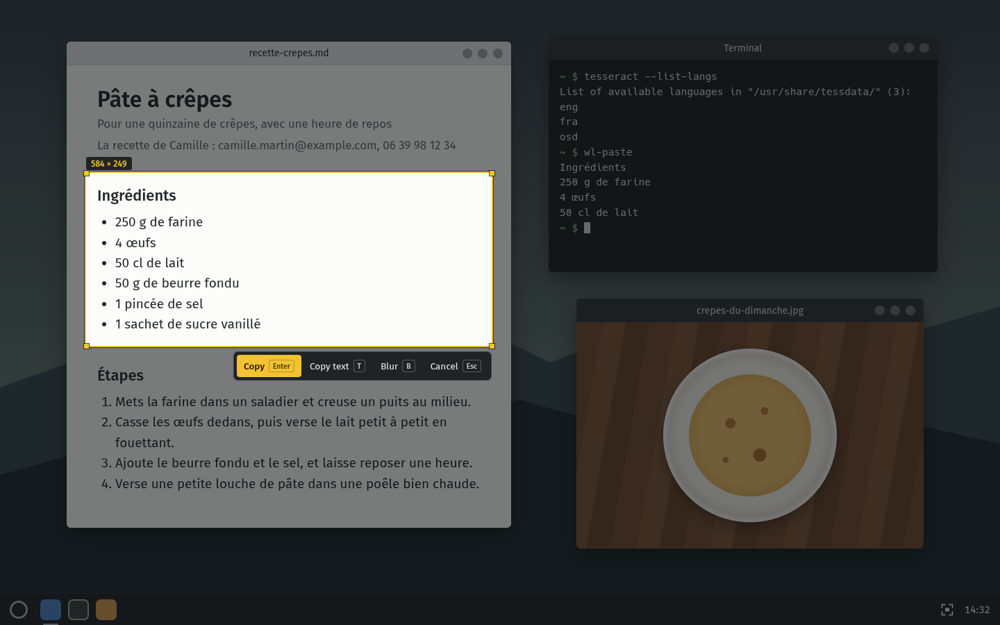
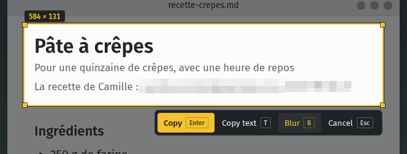
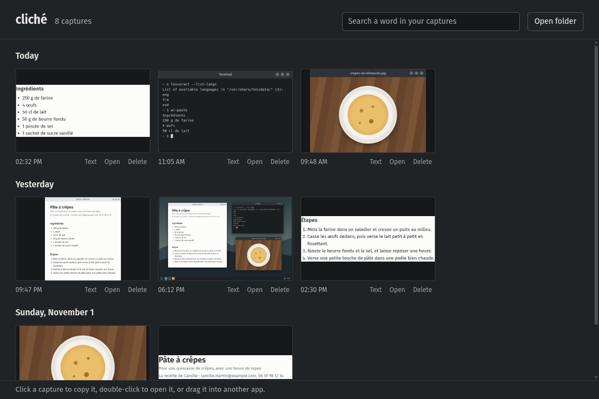
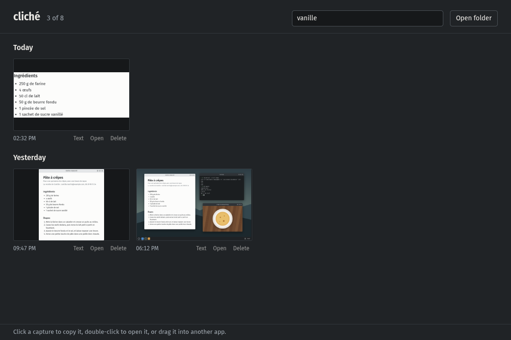

<div align="center">


# cliché

Screenshots for KDE Plasma on Wayland, with a history and local text recognition.

**English** | [Français](README.fr.md)

[](../../releases/latest)
[](../../releases/latest)

<br />



</div>

<br />

I was tired of struggling every time I wanted to copy the text out of an image on KDE. So I made cliché: press Print, pick an area, and the image lands in your clipboard. Press T instead, and you get the text from that area, read right on your machine.

## 📸 What's inside

Press `Print` and the screen freezes and dims right away. Drag to pick an area, its size in pixels shows up just above it. While you aim, a small loupe follows your cursor and magnifies the pixels around it, handy for landing exactly on the edge of a button.

<div align="center">

</div>

Once the area is drawn, you can move it, drag an edge or a corner, or nudge it pixel by pixel with the arrow keys. Enter copies the area and saves it to `Pictures/Screenshots`, then a small notification shows you a preview (click it to open the history). With no area picked, Enter takes the whole screen.

| In the selection screen                           | What it does                                  |
| ------------------------------------------------- | --------------------------------------------- |
| Drag                                              | Pick an area                                  |
| Click a window                                    | Take the whole window                         |
| Drag an edge, a corner or the inside              | Resize or move the area                       |
| Arrow keys                                        | Move the area by one pixel (10 with `Ctrl`)   |
| `Shift` + arrow keys                              | Grow or shrink the area                       |
| `Enter`, `Ctrl+C` or double-click inside the area | Copy and save                                 |
| `T`                                               | Copy the text in the area                     |
| `B`                                               | Blur personal details, then anything you want |
| `Esc` or right-click                              | Cancel                                        |

## 🪟 Capture a window in one click

Hover a window and it lights up, with its size on top. One click and it's selected, title bar included, no need to draw anything. Double-click it to copy it straight away.

<div align="center">

</div>

It also works with the Plasma panel or a dialog box.

## 🌫️ Blur before copying

Press `B` (or Blur in the bar): cliché reads the area and blurs every email address, phone number, IBAN, card number and API key it finds there on its own. At the bottom of the screen, it tells you how many it hid.

<div align="center">

</div>

Did it miss one, or do you want to hide something else? Drag over it and it turns into big pixels too. `Ctrl+Z` removes the last blur, and pressing `B` again lets you adjust the area. If you press Enter while it's still looking, the copy waits for it to finish, so nothing leaves unblurred.

> [!NOTE]
> cliché only spots what Tesseract manages to read. On tiny or blurry text, take a quick look before sending.

## 🔤 Copy the text from an image

In the selection screen, press `T` instead of Enter: cliché reads the text in the area and copies it instead of the image. A notification shows you the start of what it understood, so you can tell right away if it's right. In that case the image isn't saved, only the text goes to the clipboard.

Reading is done locally by [Tesseract](https://github.com/tesseract-ocr/tesseract), in your system language and in English. cliché enlarges small areas before reading them, so even the text of a menu or a caption comes out well.

## 🗂️ The history

The history sorts all your captures by day: today, yesterday, then the date. Click an image to copy it again, double-click to open it in your image viewer, or drag it straight into another app. Under each capture you also get Text to copy what it says, Open, and Delete, which sends it to the trash.

<div align="center">

</div>

The best part is the search. cliché reads the text of your captures in the background, so you type a word in the field at the top and it only shows the ones that contain it. No need for accents or capitals: “vanille” finds “Vanillé”.

<div align="center">

</div>

To open it, click cliché's icon in the system tray, or the notification right after a capture. Right-clicking the icon also lets you start a capture, open the folder or stop it from starting at login. On the keyboard, `Ctrl+F` jumps to the search, `T` reads the text of the selected capture and `Delete` moves it to the trash.

## 📥 Installation

1. Download `cliche-x.x.x.pacman` from the [releases page](../../releases/latest).
2. Install it with `sudo pacman -U cliche-x.x.x.pacman`. pacman pulls in `wl-clipboard` and Tesseract with English on its own.
3. Launch cliché from the menu: it settles in the system tray and will start by itself every time you log in. Press `Print` to try it.

> [!NOTE]
> By default, Spectacle (KDE's screenshot tool) keeps the Print key for itself, and cliché tells you it's taken. Go to System Settings → Keyboard → Shortcuts, remove Print from Spectacle, then give it to cliché.

The interface is in English or French, depending on your system language. To read text in another language, install its Tesseract pack (`tesseract-data-deu` for German, `tesseract-data-jpn` for Japanese…). If the one for your system language is missing, cliché tells you at startup.

The package is made for Arch and its derivatives, like CachyOS or EndeavourOS. On another distribution, cliché installs from source with `pnpm install:linux` (everything is explained in the hacking section, at the very bottom).

## 🔄 Updates

No automatic updates for now. When a new version comes out, download the new package and install it the same way, it replaces the old one. Your captures don't move, they stay in `Pictures/Screenshots`.

## 🔒 What about your data?

Nothing leaves your machine. The screen image goes straight from KWin to cliché without a temporary file, text reading runs locally with Tesseract, and cliché talks to no server at all. For the window click, it only asks KWin where the open windows are, not their title or their content.

Your captures are plain PNG files in `Pictures/Screenshots`, named after the date and time (`2026-11-04_14-32-10.png`). You can move, rename or delete them like any other file, the history keeps up on its own.

For the search, cliché keeps the text it read from your captures in `~/.config/cliche/text-index.json`. You can delete it whenever you want, it will read your captures again the next time you open the history.

## 🤔 Troubleshooting

<details>
<summary><b>“Capture failed”</b></summary>
<br />
cliché asks KWin, Plasma's window manager, for the screen image, and this message means it didn't answer. Check that you're in a Plasma 6 session on Wayland, then restart cliché. The error details are written in the notification, under the title.
</details>

<details>
<summary><b>“cliché is missing some tools”</b></summary>
<br />
The notification says which packages to install. Most of the time, it's the Tesseract pack for your language, like <code>tesseract-data-deu</code> for German.
</details>

<details>
<summary><b>The search can't find a capture</b></summary>
<br />
cliché reads your captures one by one in the background. As long as the counter at the top of the history says “N left to read”, some haven't been read yet. If the text is blurry or very small, Tesseract may have misread it: the search only finds what it understood.
</details>

<details>
<summary><b>“No text found”</b></summary>
<br />
Tesseract didn't recognize anything in the area. Take a bit more room around the text, and if it's blurry, zoom in on the page before capturing.
</details>

<details>
<summary><b>The icon disappeared from the system tray</b></summary>
<br />
It's probably hiding behind the small arrow in the system tray. Right-click the arrow, open the system tray settings and set cliché to “Always shown”.
</details>

<details>
<summary><b>I want to uninstall cliché</b></summary>
<br />
First turn off starting at login from the icon's right-click menu, then quit cliché. With the package, run <code>sudo pacman -R cliche</code>. From source, delete <code>~/Applications/cliche</code> and <code>~/.local/share/applications/cliche.desktop</code>. Your captures stay in <code>Pictures/Screenshots</code>.
</details>

---

<details>
<summary>🛠️ <b>Hacking on the code</b></summary>

<br />

Electron, electron-vite and strict TypeScript, plus two small C programs to talk to KWin. Node 24+ and pnpm 10+.

### Requirements

- KDE Plasma 6 on Wayland
- `gcc`, `pkgconf` and `libsystemd` to build the C helpers
- `wl-clipboard` and `tesseract` (with `tesseract-data-eng`) in the PATH

### Commands

```bash
pnpm install
pnpm dev              # builds the C helpers and starts the app in development mode
pnpm typecheck
pnpm lint
pnpm test
pnpm format
pnpm screenshots      # redraws the README images in French and English
pnpm build:linux      # builds dist/linux-unpacked and the dist/cliche-x.x.x.pacman package
pnpm install:linux    # builds, then installs into ~/Applications/cliche with a menu entry
```

To add a language to the interface: copy `src/shared/i18n/en.ts`, translate every text, and plug the file into `messagesFor` (`src/shared/i18n/messages.ts`). The typecheck refuses a translation that's missing a text.

To publish a version: bump `version` in `package.json`, run `pnpm build:linux`, then attach `dist/cliche-x.x.x.pacman` to a GitHub release.

### How it works

`native/kwin-grab.c` asks KWin for the screen image over D-Bus (`org.kde.KWin.ScreenShot2`) and writes it as raw pixels on its output, without going through a file. At the same time, `native/kwin-windows.c` loads a tiny KWin script that sends back the position of the visible windows, which is what makes the window click work. The selection screen is created at startup and stays hidden, ready to show up as soon as you press Print. The shortcut is registered in `kglobalaccel`, which is why it shows up in the KDE settings.

The icons are drawn in `resources/source/icon.svg` and `resources/source/tray.svg`. If you change them, `sh scripts/render-icons.sh` regenerates the PNGs (it needs `rsvg-convert`).

`pnpm screenshots` draws a fake desktop (`docs/scene`), aims at it with the loupe, hovers a window, draws a selection, blurs the personal details, fills a demo history that Tesseract really reads, then searches a word in it. It does all that once in French and once in English, saves everything in `docs/fr` and `docs/en`, and quits. It all happens off screen, so your real screen and your real captures are never touched.

| Folder                 | Role                                                                         |
| ---------------------- | ---------------------------------------------------------------------------- |
| `src/main`             | Print key, capture, clipboard, saving, OCR, search, startup                  |
| `src/preload`          | bridges between the app and each window                                      |
| `src/renderer/overlay` | the selection screen, the loupe and the blur                                 |
| `src/renderer/history` | the History window and its search                                            |
| `src/shared`           | types, IPC channels, pixelation and interface translations (`i18n`)          |
| `native`               | `kwin-grab` and `kwin-windows`, the C helpers that talk to KWin              |
| `scripts`              | helper builds, installing into `~/Applications`, icons                       |
| `docs/scene`           | the fake desktop used as a backdrop for the README images                    |
| `resources`            | icons, and the helpers built into `resources/bin` (generated, not versioned) |

</details>

## 📄 License

[MIT](LICENSE)
