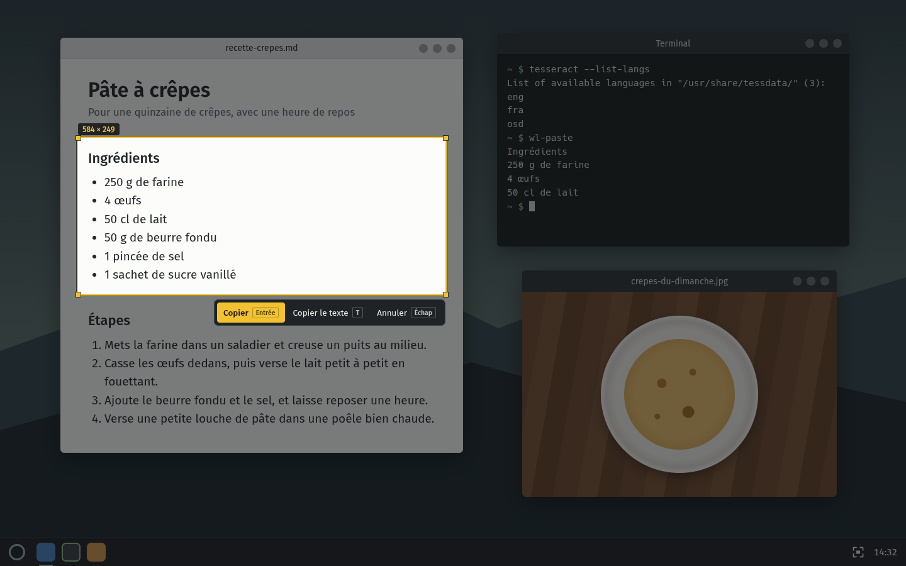

<div align="center">


# cliché

Captures d'écran pour KDE Plasma sous Wayland, avec un historique et la lecture du texte en local.

[](#-installation)
[](#-installation)

<br />



</div>

<br />

J'en avais marre de galérer dès que je voulais copier le texte d'une image sur KDE. Alors j'ai fait cliché : tu appuies sur Impr, tu choisis une zone, et l'image part dans ton presse-papiers. Appuie sur T à la place, et c'est le texte de la zone que tu récupères, lu directement sur ta machine.

## 📸 Ce qu'il y a dedans

Appuie sur `Impr`, l'écran se fige tout de suite et s'assombrit. Glisse pour choisir une zone, sa taille en pixels s'affiche juste au-dessus. Tu peux ensuite la déplacer, ou tirer sur un bord ou un coin pour l'ajuster.

Entrée copie la zone et l'enregistre dans `Images/Screenshots`, puis une petite notification te montre l'aperçu (un clic dessus ouvre l'historique). Sans zone, Entrée prend tout l'écran.

| Dans l'écran de sélection                      | Ce que ça fait              |
| ---------------------------------------------- | --------------------------- |
| Glisser                                        | Choisir une zone            |
| Glisser un bord, un coin ou l'intérieur        | Ajuster ou déplacer la zone |
| `Entrée`, `Ctrl+C` ou double-clic dans la zone | Copier et enregistrer       |
| `T`                                            | Copier le texte de la zone  |
| `Échap` ou clic droit                          | Annuler                     |

## 🔤 Copier le texte d'une image

Dans l'écran de sélection, appuie sur `T` au lieu d'Entrée : cliché lit le texte de la zone et le copie à la place de l'image. Une notification te montre le début de ce qu'il a compris, comme ça tu vois tout de suite si c'est bon. Dans ce cas l'image n'est pas enregistrée, seul le texte part dans le presse-papiers.

La lecture marche en français et en anglais, avec [Tesseract](https://github.com/tesseract-ocr/tesseract) qui tourne en local. Tu peux aussi le faire après coup sur n'importe quelle capture de l'historique.

> [!TIP]
> Les tout petits textes passent mal. Zoome sur la page avant d'appuyer sur Impr (`Ctrl` et `+` dans la plupart des apps), Tesseract lit beaucoup mieux un texte plus gros.

## 🗂️ L'historique

L'historique range toutes tes captures par jour : aujourd'hui, hier, puis la date. Clique sur une image pour la recopier, double-clique pour l'ouvrir dans ta visionneuse. Sous chaque capture, t'as aussi Texte pour copier ce qu'elle contient, Ouvrir, et Supprimer, qui l'envoie à la corbeille (tu peux donc la récupérer).

<div align="center">

</div>

Pour l'ouvrir, clique sur l'icône de cliché dans la barre système, ou sur la notification juste après une capture. Au clavier, `T` lit le texte de la capture sélectionnée et `Suppr` la met à la corbeille.

## 🖱️ L'icône de la barre système

Un clic sur l'icône ouvre l'historique. Le clic droit te propose aussi de lancer une capture, d'ouvrir le dossier des captures ou de quitter, pratique si la touche Impr est prise par autre chose.

## 📥 Installation

Pas encore de version à télécharger, cliché s'installe depuis les sources. Il te faut KDE Plasma 6 sous Wayland, Node 24+ et pnpm 10+.

1. Installe les outils dont cliché a besoin. Sur Arch ou CachyOS :
   ```sh
   sudo pacman -S wl-clipboard tesseract tesseract-data-fra tesseract-data-eng base-devel
   ```
2. Récupère le code et lance l'installation :
   ```sh
   git clone https://github.com/qyrn/cliche.git
   cd cliche
   pnpm install
   pnpm install:linux
   ```
3. C'est prêt : cliché attend dans la barre système, et il se relance tout seul à chaque ouverture de session. Appuie sur `Impr` pour essayer.

> [!NOTE]
> Par défaut, Spectacle (l'outil de capture de KDE) garde la touche Impr pour lui, et cliché te prévient qu'elle est déjà prise. Va dans Configuration du système → Clavier → Raccourcis, retire Impr à Spectacle, puis donne-la à cliché.

## 🔄 Les mises à jour

Pas de mise à jour automatique pour l'instant. Récupère la dernière version du code avec `git pull` et relance `pnpm install:linux` : le script ferme cliché, remplace l'ancienne version et le relance. Tes captures ne bougent pas, elles restent dans `Images/Screenshots`.

## 🔒 Et tes données ?

Rien ne sort de ta machine. L'image de l'écran passe directement de KWin à cliché sans fichier temporaire, la lecture du texte tourne en local avec Tesseract, et cliché ne contacte aucun serveur.

Tes captures sont de simples fichiers PNG dans `Images/Screenshots`, nommés avec la date et l'heure (`2026-11-04_14-32-10.png`). Tu peux les déplacer, les renommer ou les supprimer comme n'importe quel fichier, l'historique suit tout seul.

## 🤔 Si ça coince

<details>
<summary><b>« La capture a échoué »</b></summary>
<br />
cliché demande l'image de l'écran à KWin, le gestionnaire de fenêtres de Plasma, et ce message veut dire qu'il n'a pas répondu. Vérifie que t'es bien dans une session Plasma 6 sous Wayland, puis relance cliché. Le détail de l'erreur est écrit dans la notification, sous le titre.
</details>

<details>
<summary><b>Un message parle de <code>ENOENT</code> ou de <code>traineddata</code></b></summary>
<br />
Il manque un outil. <code>wl-copy</code> vient du paquet <code>wl-clipboard</code>, <code>tesseract</code> du paquet du même nom, et les fichiers <code>traineddata</code> de <code>tesseract-data-fra</code> et <code>tesseract-data-eng</code>.
</details>

<details>
<summary><b>« Aucun texte trouvé »</b></summary>
<br />
Tesseract n'a rien reconnu dans la zone. Prends un peu plus large autour du texte, et s'il est petit, zoome sur la page avant de capturer.
</details>

<details>
<summary><b>L'icône a disparu de la barre système</b></summary>
<br />
Elle se cache sûrement derrière la petite flèche de la barre système. Fais un clic droit sur la flèche, ouvre les réglages de la boîte à miniatures et passe cliché sur « Toujours affiché ».
</details>

<details>
<summary><b>Je veux désinstaller cliché</b></summary>
<br />
Quitte-le depuis l'icône, puis supprime <code>~/Applications/cliche</code>, <code>~/.local/share/applications/cliche.desktop</code> et <code>~/.config/autostart/cliche.desktop</code>. Tes captures restent dans <code>Images/Screenshots</code>.
</details>

---

<details>
<summary>🛠️ <b>Pour bidouiller le code</b></summary>

<br />

Electron, electron-vite et TypeScript strict, plus un petit programme en C pour parler à KWin. Node 24+ et pnpm 10+.

### Prérequis

- KDE Plasma 6 sous Wayland
- `gcc`, `pkgconf` et `libsystemd` pour compiler le helper C
- `wl-clipboard` et `tesseract` (avec `tesseract-data-fra` et `tesseract-data-eng`) dans le PATH

### Commandes

```bash
pnpm install
pnpm dev              # compile le helper C et lance l'app en mode développement
pnpm typecheck
pnpm lint
pnpm format
pnpm build:linux      # génère dist/linux-unpacked
pnpm install:linux    # build, puis installe dans ~/Applications/cliche avec le menu et le démarrage auto
```

### Comment ça marche

`native/kwin-grab.c` demande l'image de l'écran à KWin par D-Bus (`org.kde.KWin.ScreenShot2`) et la renvoie en pixels bruts sur sa sortie, sans passer par un fichier. La fenêtre de sélection est créée au démarrage et reste cachée, prête à s'afficher dès que tu appuies sur Impr. Le raccourci est enregistré dans `kglobalaccel`, c'est pour ça qu'il apparaît dans les réglages de KDE.

Les icônes sont dessinées dans `resources/source/icon.svg` et `resources/source/tray.svg`. Si tu les modifies, `sh scripts/render-icons.sh` régénère les PNG (il faut `rsvg-convert`).

Pour refaire les captures du README : `CLICHE_SCREENSHOT=docs pnpm dev`. L'app dessine un faux bureau (`docs/scene`), y trace une sélection et remplit un historique de démo, enregistre `docs/hero.png` et `docs/history.png`, puis se ferme. Tout se passe hors écran, donc ton vrai écran et tes vraies captures ne sont jamais touchés.

| Dossier                | Rôle                                                                        |
| ---------------------- | --------------------------------------------------------------------------- |
| `src/main`             | raccourci Impr, capture, presse-papiers, enregistrement, OCR, barre système |
| `src/preload`          | ponts entre l'app et chaque fenêtre                                         |
| `src/renderer/overlay` | l'écran de sélection                                                        |
| `src/renderer/history` | la fenêtre Historique                                                       |
| `src/shared`           | types et canaux IPC partagés                                                |
| `native`               | `kwin-grab`, le helper C qui demande l'image à KWin                         |
| `scripts`              | installation dans `~/Applications`, génération des icônes                   |
| `docs/scene`           | le faux bureau qui sert de fond aux captures du README                      |
| `resources`            | icônes, et le helper compilé dans `resources/bin` (généré, pas versionné)   |

</details>

## 📄 Licence

[MIT](LICENSE)
